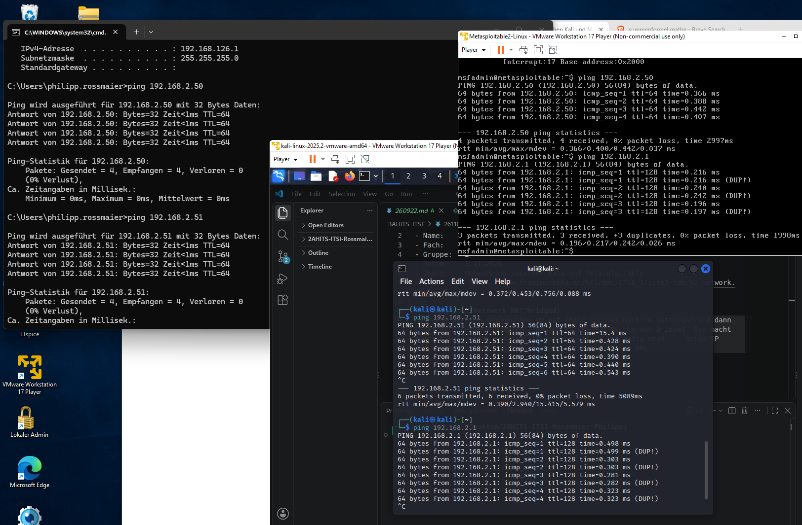

- Klasse:       3AHITS
- Name:         Philipp Rossmaier
- Fach:         ITSE
- Gruppe:   2
- Datum:    3.11.2026
- Übung:    Networking zwischen Kali und Metasploitable
- Link:      https://www.franzmatejka.at/htl/doc/ITSI_3/itsi3-lab/02_network.html
--- 
## Übung 2.1 (Netzwerk NAT/Bridged)
Man geht auf die gewünschten VM auf "Edit virtual machine settings" und dann Links auf "Network Adapter". Danach klickt man Rechts auf Bridged. Das macht man mit beiden VMs und dann findet man mit ``` ifconfig eth0 ``` beide IP addressen raus und pingt sich gegenseitig mit beiden VMs. 


